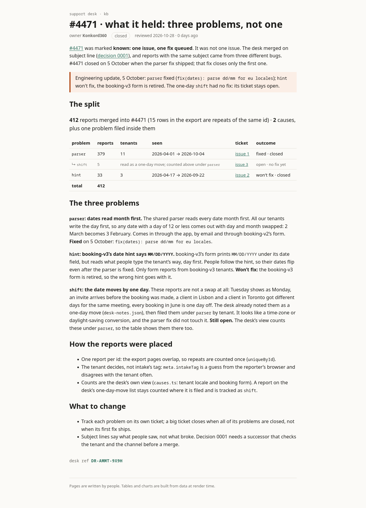

# support-kb · #4471 split into its problems

The support desk's kb export, with one page added about what ticket #4471 held.

## The page

- **Source (.svx):** [`src/routes/kb/incidents/4471-split/+page.svx`](src/routes/kb/incidents/4471-split/+page.svx)
- **As the desk sees it (rendered):** [`rendered/kb-incidents-4471-split.html`](rendered/kb-incidents-4471-split.html) · screenshot below
- Signed with the course ticket · desk ref **DR-AMMT-9X9H**



## The tickets

| ticket | problem | reports | outcome |
|---|---|---|---|
| [#1](../../issues/1) | parser reads dates month first for day-first tenants | 379 | fixed · closed |
| [#2](../../issues/2) | booking-v3 form hint says `MM/DD/YYYY` but reads day first | 33 | won't fix · closed |
| [#3](../../issues/3) | dates move by one day (time-zone conversion) | 5 (filed under parser) | open |

## Build

```
npm install && npm run build   # static site in build/
```

---

# kb — the support knowledge base

**kb** = knowledge base. What the support desk knows about how our products break, written
down where the code can keep it honest.

One desk takes reports for every product we run: `sched-prod` (calendar invites for about
300k people) and the rest. When something
goes wrong, the reports reach the desk first. This kb is how the desk triages them, what each
incident turned out to be, and why we decided what we decided.

## What's here

```
src/routes/kb/      the pages (.svx: Markdown with components)
  triage/           how the desk handles incoming reports
  incidents/        one page per big ticket
  decisions/        numbered decision records
src/lib/kb/         components and the logic they run
src/lib/layouts/    the frame every page shares
src/lib/data/       exports from the ticket system
```

## Conventions

- Words in the page, logic in `src/lib` (imported as `#lib/…`). A number that can be computed belongs in a component.
- Every page starts with frontmatter: `title`, `owner`, `status`, `reviewed`.
- A decision is never edited after it is accepted. A new record replaces it.
- A page you add is signed: its frontmatter carries your `signature` and it ends with `<RenderStamp {signature} />`, so the desk knows who wrote it.

## Owners

Support desk. Decision records: whoever signed them.

---

Exported 2026-10-04 from the `support` repo, `apps/kb/` → `src/`.
