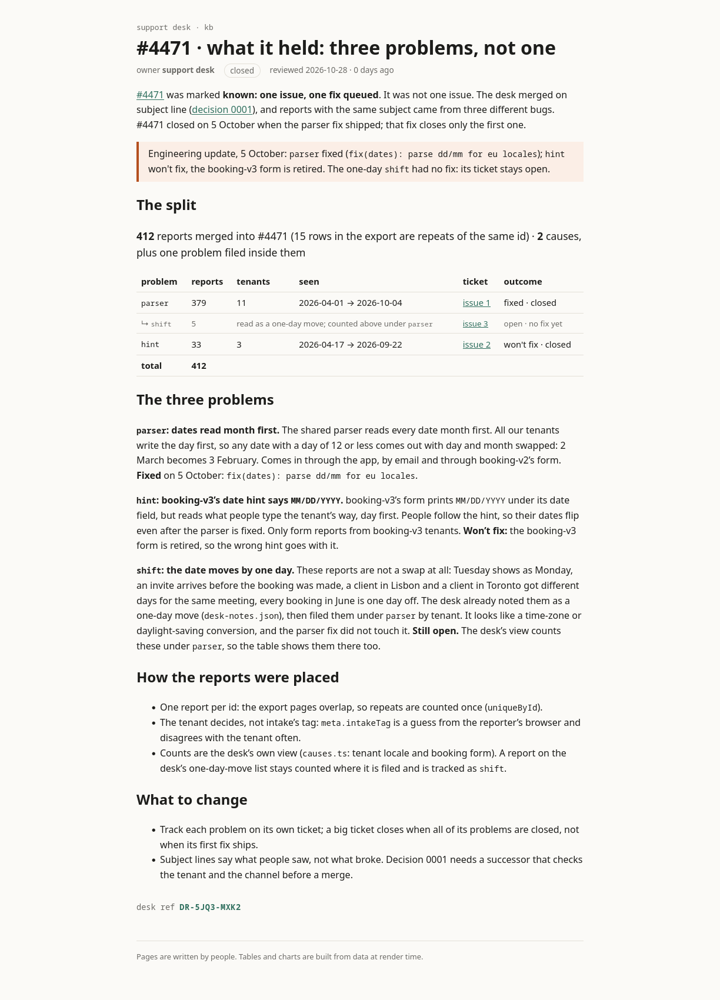

# support-kb · #4471 split into its problems

The support desk's kb export, with one page added about what ticket #4471 held.

## The page

- **Source (.svx):** [`support-kb/src/routes/kb/incidents/4471-split/+page.svx`](support-kb/src/routes/kb/incidents/4471-split/+page.svx)
- **As the desk sees it (rendered):** [`support-kb/rendered/kb-incidents-4471-split.html`](support-kb/rendered/kb-incidents-4471-split.html) · screenshot below
- Signed `Konkord360` · desk ref **DR-5JQ3-MXK2**



## The tickets

| ticket | problem | reports | outcome |
|---|---|---|---|
| [#1](../../issues/1) | parser reads dates month first for day-first tenants | 379 | fixed · closed |
| [#2](../../issues/2) | booking-v3 form hint says `MM/DD/YYYY` but reads day first | 33 | won't fix · closed |
| [#3](../../issues/3) | dates move by one day (time-zone conversion) | 5 (filed under parser) | open |

## Build

```
cd support-kb && npm install && npm run build   # static site in support-kb/build/
```
